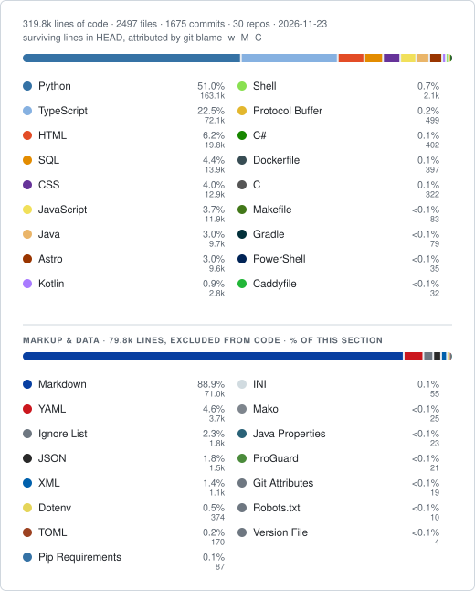

## Hi, I'm Pedro

Full Stack and software architecture. I co-founded **FoodCash**, a school payments platform
running in production since 2024, so most of what I know comes from code where getting it
wrong costs someone money.

I care about correctness more than cleverness, data models that make invalid states hard to
represent, tenant isolation enforced by the database schema rather than by convention, and
architectural rules that fail the build instead of living in a wiki nobody reads.

Systems and Computer Engineering at Universidad Pontificia Bolivariana, Medellín.
Currently open to work.

### Selected work

**[TIMU](https://github.com/luisseoanes/Timu)** - veterinary care platform built around
family memberships, plans, billing, clinical records, routing and campaigns, with a staff
panel, a family portal and a partner-clinic portal. FastAPI and React over PostgreSQL 18
with row-level security and integrity triggers, Celery and Redis for scheduled work, signed
S3 URLs, WhatsApp Cloud API, Wompi webhooks and OR-Tools for route planning.
→ [my commits](https://github.com/luisseoanes/Timu/commits/main?author=pjg09)

**[Pay(A)gents](https://github.com/luisseoanes/paygent)** - delegable payments on the
Interledger Open Payments standard. One payer approves a single grant, family members,
devices and AI agents spend within signed sub-mandates carved from it, and permissions can
only narrow down the tree. Winner of the Punto Red track, USD $5,000. I built the API core,
the Fastify mandate gateway, the PostgreSQL persistence layer, and the locking that stops
two concurrent payments from exceeding a mandate cap.
→ [my commits](https://github.com/luisseoanes/paygent/commits/main?author=pjg09)

**[Veritas](https://github.com/luisseoanes/Veritas)** - neuro-symbolic commercial
intelligence agent, a knowledge graph of 230 components and 2,277 edges plus a CSP solver,
so recommendations are valid by construction. The language model translates, it does not
decide. Third place out of more than 20 teams. I isolated the model from the decision core
and enforced that boundary with a test that parses the project AST and fails CI if the graph
or solver modules import the LLM layer.

**[dfsha](https://github.com/pjg09/dfsha)** - a distributed file system with high
availability, block partitioning, replication, consistency and a server-to-server service.

**[minios-lab](https://github.com/pjg09/minios-lab)** - a round-robin scheduler and an
interactive shell, written in C. Operating systems from the inside.

### Also

- **[Biblioteca-Elysium](https://github.com/pjg09/Biblioteca-Elysium)** - the same library
  system built twice, as a monolith and as microservices with DDD, to compare the two under
  identical requirements instead of assuming one.
- **[Flor](https://github.com/rosvend/Flor)** - automates the non-discretionary stages of
  public-sector citizen requests for the Medellín city government, with RAG-drafted replies
  over a vector database.
- **[biga-app](https://github.com/pjg09/biga-app)** - attendance, early departures and school
  meal tracking for public schools, with a chained-HMAC audit trail that makes delivery
  records tamper-evident. Built for a two-developer team, never reached production.
- **[5.7 Onda Creativa](https://www.ocl57group.com)** - live corporate site I built and
  deployed alone ([source](https://github.com/pjg09/pagina-web-5.7)). A Wompi payment
  triggers a webhook that issues a single-use token by email, and the token unlocks the
  booking flow.

### How I work with coding agents

I build with Claude Code daily, and most of the work is in the harness around the model
rather than the prompts:

- **Constraints enforced by CI, not by instructions.** In Veritas a test parses the project
  AST so the graph and solver modules cannot import the LLM layer, in Pay(A)gents a test
  guards the API layer boundaries. An agent cannot quietly violate the architecture, because
  the build fails.
- **Context files kept as a first-class artifact.** `CLAUDE.md` per area rather than one
  root file, reviewed when a session closes, I check what the session changed against what
  the docs claim, and close the gaps in the same commit.
- **A written record of the traps.** A `trampas.md` collects the mistakes that cost real
  time, so the next session starts knowing them instead of rediscovering them.
- **Prompts versioned and evaluated before they ship**, the same as any other code path.
- **Honest attribution.** Pay(A)gents carries an
  [AI usage declaration](https://github.com/luisseoanes/paygent/blob/main/AI_USAGE.md) with
  the literal prompts per session, which files each one touched, and which results were
  verified against the real Open Payments Test Wallet rather than a simulated client.

<h3>Languages I have written</h3>

<picture>
  <source media="(prefers-color-scheme: dark)" srcset="./profile/langs-dark.svg">
  
</picture>

Computed locally across public and private repos: it counts the lines in
`HEAD` that `git blame` attributes to my commit identities, discarding
dependencies, lockfiles, minified files and generated code. It is not how big my
repos are, it is the code I wrote that is still alive.

---

